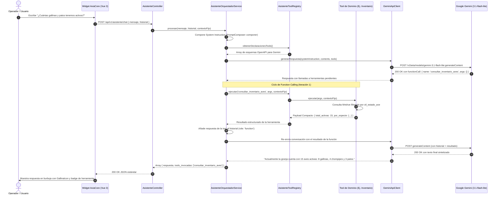
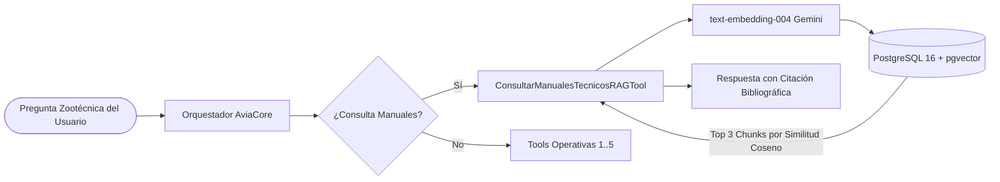

# Arquitectura del Asistente AviaCore: Harness, Function Calling y Tools

> **Proyecto:** Granja Avícola Inteligente (Sistema de Control Integral)  
> **Componente:** Asistente Virtual Conversacional (**AviaCore**)  
> **Ubicación:** `avicola-backend-api` & `avicola-frontend`  
> **Estándar:** Spec-Driven Development (SDD) & Clean Architecture  
> **Fecha de Elaboración:** 09 de Noviembre de 2026  

---

## 1. Visión General y Filosofía de Diseño

**AviaCore** es el asistente virtual de inteligencia artificial integrado en la plataforma de la Granja Avícola Inteligente. Su propósito es acompañar al personal operativo, zootecnistas y administradores en la consulta ágil de datos de campo, censos de población avícola, control de postura de huevos, suministro de alimentos, finanzas de la granja y, en etapas posteriores, recomendaciones zootécnicas especializadas extraídas de manuales técnicos.

```
┌────────────────────────────────────────────────────────────────────────┐
│                        INTERFAZ DE USUARIO (SPA)                       │
│  AviaCore Widget (Vue 3 + Pinia + Tailwind CSS + GallinaIcon)          │
└───────────────────────────────────┬────────────────────────────────────┘
                                    │ POST /api/v1/asistente/chat
                                    ▼
┌────────────────────────────────────────────────────────────────────────┐
│                        BACKEND API (LARAVEL 11)                        │
│  AsistenteController ──► AsistenteOrquestadorService                   │
│                                │                                       │
│          ┌─────────────────────┴─────────────────────┐                 │
│          ▼                                           ▼                 │
│   PromptComposer (4 capas)                  AsistenteToolRegistry      │
│          │                                           │                 │
│          ▼                                           ▼                 │
│   GeminiApiClient                     5 Tools de Dominio Específicas   │
│   (gemini-3.1-flash-lite)             (Inventario, Huevos, Gastos, ...)│
└───────────────────────────────────┬────────────────────────────────────┘
                                    │
                                    ▼
                 Base de Datos PostgreSQL 16 / SQLite Test
```

### Principios Rectores de Arquitectura

1. **Zero-Hallucination via Tool Grounding (Cero Alucinación):**  
   El modelo de lenguaje (LLM) **nunca** inventa cifras, conteos, ubicaciones o estados contables. Su única fuente de verdad sobre el estado actual de la granja son las herramientas autorizadas (*tools*). Si los datos no existen en la base de datos, el asistente lo comunica honestamente sin especular.
2. **Seguridad y Anti-IDOR (`contexto_fijo`):**  
   El LLM solo recibe esquemas de parámetros de negocio (fechas, especie, concepto). Parámetros sensibles como el identificador del usuario autenticado (`id_usuario`) son inyectados directamente por el backend de manera inmutable, impidiendo cualquier manipulación o intento de escalamiento horizontal (IDOR).
3. **Open-Closed Principle (OCP) y Desacoplamiento:**  
   El orquestador no contiene sentencias condicionales `switch/case` ni conoce las tablas del sistema. Cada herramienta es una clase aislada que implementa la interfaz `AsistenteToolInterface`. Agregar una nueva funcionalidad (por ejemplo, RAG en Etapa 8) no requiere modificar el controlador ni el orquestador principal.
4. **Modo Operate y UX Agropecuaria:**  
   Cumpliendo con `avicola-frontend/DESIGN.md`, las respuestas son concisas (1 a 3 oraciones), en trato de tú profesional, con formato de fechas estricto (`DD-MM-YYYY`) y respaldadas visualmente por la identidad corporativa y el imagotipo [`GallinaIcon.vue`].

---

## 2. Explicación General y Funcionamiento en Lenguaje Natural

Para comprender cómo opera AviaCore de manera intuitiva sin necesidad de sumergirse de inmediato en código o esquemas técnicos, imaginemos el sistema como un **restaurante de alta cocina bien coordinado**:

* El **Usuario (Operador / Administrador)** es el **comensal** que realiza una consulta o pide un platillo.
* El **Frontend (Vue 3 + Pinia)** es la **mesa y la carta**, donde el comensal visualiza el menú e interactúa con comodidad.
* El **Controlador (`AsistenteController`)** es el **recepcionista en la puerta**, quien verifica que el cliente tenga reservación y esté autenticado con su carnet.
* El **Orquestador (`AsistenteOrquestadorService`)** es el **jefe de cocina (maître)**, quien coordina a todo el equipo y hace respetar estrictamente las normas de la casa.
* **Google Gemini (LLM `gemini-3.1-flash-lite`)** es el **chef consultor inteligente**, quien domina el lenguaje humano, comprende la intención del comensal y decide qué ingredientes se requieren para satisfacer la solicitud.
* Las **Herramientas (Tools de Dominio)** son los **cocineros especializados de cada estación**, los únicos autorizados para acceder a la despensa y preparar las porciones requeridas.
* La **Base de Datos (PostgreSQL 16)** es la **bodega o despensa central**, donde se custodian los datos reales y auditados de las aves, la postura y las finanzas.

### El Viaje de un Mensaje en 7 Pasos Simples

```
[1. Usuario escribe en Chat]
           │
           ▼
[2. Frontend envía a la API] ──► [3. Controlador valida sesión e inyecta usuario]
                                                   │
                                                   ▼
                                     [4. Orquestador prepara reglas]
                                                   │
                                                   ▼
                                      [5. Gemini pide datos reales]
                                                   │ (Function Calling)
                                                   ▼
                                  [6. Tool consulta PostgreSQL]
                                                   │ (Payload compacto)
                                                   ▼
                                  [7. Gemini redacta la respuesta]
                                                   │
                                                   ▼
[Operador lee respuesta en pantalla con GallinaIcon y Badge de Tool]
```

1. **Paso 1: El usuario escribe su consulta**  
   El operador abre la ventanita de AviaCore en el navegador (`http://localhost:5173`) y escribe en lenguaje natural:  
   *`"¿Cuántas aves tenemos activas en la granja?"`* y presiona Enviar.
2. **Paso 2: El frontend prepara la experiencia**  
   Al instante, el componente [`AsistenteChatWidget.vue`] agrega el mensaje en una burbuja color salvia y activa la animación de tres puntos pulsantes ([`AsistenteIndicador.vue`]), informando visualmente que AviaCore está trabajando en la respuesta.
3. **Paso 3: El controlador recibe y protege el acceso**  
   La petición viaja vía HTTP segura (`POST /api/v1/asistente/chat`). [`ChatRequest.php`] verifica que el mensaje sea válido y [`AsistenteController.php`] extrae el identificador real del usuario autenticado (`$contextoFijo`), impidiendo que nadie pueda falsificar su identidad.
4. **Paso 4: El orquestador ensambla el contexto**  
   El orquestador toma el mensaje y prepara el paquete completo para la IA:
   - Las **reglas de la granja**: las 4 capas de [`PromptComposer.php`] (identidad AviaCore, reglas anti-hackeo, estilo conciso de 1-3 frases y normas zootécnicas).
   - El **menú de herramientas**: la lista de tools registradas en [`AsistenteToolRegistry.php`] (inventario, huevos, gastos, ubicación y raciones).
5. **Paso 5: La IA decide qué información necesita (*Function Calling*)**  
   Gemini lee la pregunta. Al estar estrictamente instruido para no especular ni inventar cifras, no emite texto inmediatamente, sino que responde al servidor:  
   👉 *"Para responder con exactitud, requiero que ejecutes la herramienta `consultar_inventario_aves`"*.
6. **Paso 6: La herramienta consulta los datos reales en PostgreSQL**  
   El orquestador recibe la instrucción y delega la ejecución en [`ConsultarInventarioAvesTool.php`]. La herramienta realiza una consulta SQL optimizada a la base de datos y genera una respuesta compacta:  
   `{ "total_activas": 15, "por_especie": { "Gallina": 10, "Chompipe": 5 }, "por_sexo": { "Hembra": 10, "Macho": 5 } }`.
7. **Paso 7: Gemini sintetiza la respuesta humana y el frontend la presenta**  
   El orquestador le reenvía las cifras verídicas a Gemini, quien redacta la respuesta final en lenguaje amigable:  
   > *"Actualmente la granja cuenta con 15 aves activas: 10 gallinas criollas y 5 chompipes (10 hembras y 5 machos). 🐔"*  
   
   El frontend recibe este texto, apaga los puntos pulsantes y dibuja la burbuja del asistente con el avatar corporativo [`GallinaIcon.vue`] y una etiqueta transparente que dice: `[⚙ Inventario de aves]`. Todo este ciclo ocurre en apenas **1.5 a 2.5 segundos**.

---

## 3. Flujo Técnico del Harness (Ciclo de Vida de un Mensaje y Secuencia)

A nivel de arquitectura de software, el siguiente diagrama de secuencia describe el flujo detallado de llamadas internas entre capas y servicios:



### Detalle de las Etapas del Pipeline

1. **Recepción y Validación (`ChatRequest`):**  
   El endpoint valida que el mensaje no esté vacío (máximo 1,000 caracteres) y que el historial opcional cumpla con el esquema `{ role: 'user'|'model', text: string }`.
2. **Inyección de Contexto Fijo:**  
   El controlador extrae de la petición autenticada vía Laravel Sanctum el `id_usuario` y lo empaqueta en un array inmutable:
   ```php
   $contextoFijo = [
       'id_usuario' => $request->user()->id_usuario,
       'rol' => $request->user()->id_rol,
   ];
   ```
3. **Orquestación con Gemini Function Calling:**  
   `AsistenteOrquestadorService` coordina la llamada al modelo. Si el modelo devuelve una o más solicitudes `functionCall`, el orquestador:
   - Resuelve la herramienta en `AsistenteToolRegistry`.
   - Inyecta el `$contextoFijo` a la ejecución.
   - Serializa la respuesta como `functionResponse`.
   - Reinvoca al modelo de lenguaje para que redacte la respuesta final en lenguaje natural comprensible para el operador.
4. **Protección contra Bucles Infinitos:**  
   El orquestador tiene una constante de seguridad `MAX_ITERACIONES = 3`. Si por algún fallo el modelo entra en un bucle solicitando herramientas de forma descontrolada, el orquestador frena la recursión y entrega un mensaje controlado para evitar sobrecostos o bloqueos.

---

## 4. Composición del System Prompt en 4 Capas Inmutables

El comportamiento de AviaCore se rige mediante un *System Instruction* dinámico estructurado por la clase [`PromptComposer.php`]:

```
┌────────────────────────────────────────────────────────┐
│  CAPA 1: INVARIANTE                                    │
│  - Identidad: AviaCore.                                │
│  - Misión de asistencia operativa y zootécnica.        │
│  - Prohibición estricta de alucinación de cifras.      │
├────────────────────────────────────────────────────────┤
│  CAPA 2: SEGURIDAD                                     │
│  - Anti-Jailbreak y Anti-Prompt-Injection.             │
│  - Protección de esquemas internos y credenciales.     │
│  - Neutralidad y trato ante manipulación.              │
├────────────────────────────────────────────────────────┤
│  CAPA 3: ESTILO (MODO OPERATE)                         │
│  - Brevedad: 1 a 3 oraciones concisas o viñetas.       │
│  - Tono: cercano y profesional agropecuario (tú).      │
│  - Fechas: DD-MM-YYYY obligatorio (ej. 09-11-2026).    │
│  - Máximo 1 emoji contextual (ej. 🥚, 🐔).             │
├────────────────────────────────────────────────────────┤
│  CAPA 4: DOMINIO AVÍCOLA                               │
│  - Casitas e instalaciones vs Divisiones y corrales.   │
│  - Regla biológica: separación estricta de especies.   │
│  - Huevos aprovechables = (recolectados - rotos).      │
│  - Cero resultados: respuesta constructiva y clara.   │
└────────────────────────────────────────────────────────┘
```

Esta arquitectura por capas permite modificar las reglas de estilo o agregar reglas de dominio zootécnico (como guías sanitarias) sin alterar las directrices de seguridad ni la identidad del asistente.

---

## 5. Patrón de Herramientas (Tools / Function Calling)

### 5.1 Contrato Formal (`AsistenteToolInterface`)

Todas las herramientas implementan la siguiente interfaz PHP:

```php
namespace App\Services\Asistente\Contracts;

interface AsistenteToolInterface
{
    public function obtenerNombre(): string;
    public function obtenerDescripcion(): string;
    public function obtenerDeclaracionTool(): array;
    public function ejecutar(array $argumentos, array $contextoFijo): array;
}
```

La función `obtenerDeclaracionTool()` genera el esquema JSON compliant con **OpenAPI 3.0** que Gemini requiere para decidir cuándo y cómo llamar a la herramienta.

### 5.2 Registro OCP (`AsistenteToolRegistry`)

El registro central no conoce las implementaciones directas; las herramientas se registran e inyectan en [`AppServiceProvider.php`]:

```php
$this->app->singleton(AsistenteToolRegistry::class, function ($app) {
    $registry = new AsistenteToolRegistry();
    foreach (self::$ASISTENTE_TOOLS as $toolClass) {
        $registry->registrar($app->make($toolClass));
    }
    return $registry;
});
```

### 5.3 Principio de Payloads Compactos (Optimización de Context Window)

Las herramientas de AviaCore nunca retornan colecciones masivas de modelos Eloquent con cientos de columnas innecesarias. Retornan **agregaciones SQL ligeras** preparadas para el consumo óptimo del LLM:

- **Mínimo consumo de tokens:** Respuestas de 50 a 150 tokens en lugar de miles de tokens de volcado crudo.
- **Menor latencia:** Reducción drástica en el tiempo de procesamiento de Gemini.
- **Ahorro de costos:** Menor volumen de tokens de entrada/salida en el plan de API.

---

## 6. Catálogo de Herramientas Implementadas (Etapa 7)

| Nombre de la Herramienta | Entidades Involucradas | Propósito y Argumentos | Salida Compacta |
|---|---|---|---|
| `consultar_inventario_aves` | `MntAve`, `CtlEspecieAve`, `CtlEstadoAve` | Conteo de población avícola activa. Filtros opcionales: `especie`, `sexo`. | Total de aves activas, desglose por especie y desglose por sexo. |
| `consultar_produccion_huevos` | `MntControlPosturaHuevos` | Balance de postura y recolección. Argumentos: `fecha_desde`, `fecha_hasta`. | Total recolectados, rotos y cálculo de huevos aprovechables. |
| `consultar_gastos_periodo` | `MntControlGasto`, `CtlConceptoGasto` | Reporte financiero de egresos. Argumentos: `fecha_desde`, `fecha_hasta`, `concepto`. | Monto total en USD, cantidad de registros y desglose por concepto. |
| `consultar_ubicacion_ave` | `MntAve`, `CtlDivision`, `CtlCasita` | Trazabilidad física de un animal por su código o anillo. Argumento obligatorio: `codigo_ave`. | Código, especie, nombre de la casita, número de división y estado biológico. |
| `consultar_raciones_alimento` | `MntControlAlimento`, `CtlDivision`, `CtlEspecieAve` | Historial de alimentación suministrada. Argumentos: `dias_atras` (default 7), `especie`. | Total de raciones en kilogramos, desglose por especie y registros recientes. |

---

## 7. Frontend: Widget Conversacional y Tokens Visuales

El widget de AviaCore fue diseñado respetando rigurosamente los principios de accesibilidad, modularidad y paleta cromática definidos en `avicola-frontend/DESIGN.md`:

```
┌────────────────────────────────────────────────────────┐
│  AviaCore  ●                                  [🗑]  [v] │
│  Consultas operativas en lenguaje natural              │
├────────────────────────────────────────────────────────┤
│                                                        │
│  [🐔] AviaCore                                         │
│  Actualmente la granja cuenta con 15 aves activas:     │
│  • 10 Gallinas criollas                                │
│  • 5 Chompipes                                         │
│                                                        │
│  [ ⚙ Inventario de aves ]                              │
│                                                        │
├────────────────────────────────────────────────────────┤
│ [ Pregunta sobre aves, huevos, gastos...       ] [ ► ] │
│ Presiona Enter para enviar      AviaCore IA + F.Calling│
└────────────────────────────────────────────────────────┘
```

### Componentes Involucrados

1. [`AsistenteChatWidget.vue`]:
   - Ventana modal flotante anclada en la esquina inferior derecha (`z-40`).
   - Cabecera corporativa en color `bosque` (`#244837`) con el imagotipo [`GallinaIcon.vue`].
   - Indicador de estado operativo con animación de pulso verde (`salvia`).
   - Sugerencias rápidas de preguntas frecuentes en el estado vacío inicial.
   - Botón disparador circular con contador dinámico (badge) de mensajes pendientes.
2. [`AsistenteMensaje.vue`]:
   - Distinción visual clara entre mensajes del usuario (`salvia`) y respuestas del modelo (`bosque`).
   - Avatar corporativo `GallinaIcon.vue` en los mensajes de AviaCore.
   - Formateador ligero para negritas (`**`), listas con viñetas y saltos de línea.
   - **Badge de Herramienta Ejecutada:** Al invocarse una tool, muestra una etiqueta sutil (ej. *"Inventario de aves"*) para brindar total transparencia sobre el origen del dato.
3. [`AsistenteIndicador.vue`]:
   - Animación de tres puntos pulsantes en color `salvia` para indicar que el modelo está ejecutando herramientas o razonando la respuesta.
4. [`stores/asistente.js` (Pinia)]:
   - Gestión centralizada del estado: visibilidad (`isOpen`), lista reactiva de mensajes, bandera de carga (`cargando`) y acciones `enviarMensaje()` y `limpiarHistorial()`.

---

## 8. Pruebas Automatizadas y Estrategia de Calidad (TDD)

El asistente cuenta con una suite completa de **18 pruebas automatizadas** en [`tests/Feature/AsistenteTest.php`], ejecutadas en un entorno 100% aislado en memoria (SQLite) para garantizar que la base de datos PostgreSQL de desarrollo no sea modificada ni corrompida:

```bash
docker compose -f avicola-backend-api/docker-compose.yml exec \
  -e DB_CONNECTION=sqlite \
  -e DB_DATABASE=:memory: \
  -e DB_URL= \
  api php artisan test --filter=AsistenteTest
```

### Cobertura de Pruebas

- **Composición del Prompt:** Verifica la presencia de las 4 capas y el nombre AviaCore.
- **Generación de Esquemas OpenAPI:** Comprueba que las herramientas produzcan el JSON Schema compatible con Gemini.
- **Inyección Anti-IDOR:** Valida que el contexto fijo de sesión no sea sobrescrito por argumentos del LLM.
- **Ejecución Unitaria de las 5 Tools:** Verifica que cada herramienta calcule y devuelva los datos correctos de aves, huevos, gastos, ubicación y alimentos.
- **Resiliencia ante Fallos de Red / 404 / 503:** Verifica el comportamiento seguro y mensajes legibles cuando la API de Gemini no responde.
- **Prevención de Bucles Infinitos:** Garantiza que el orquestador se detenga limpiamente al alcanzar el límite de 3 iteraciones de Function Calling.
- **Endpoint HTTP Seguro:** Valida autenticación Sanctum y formato de respuesta JSON.

---

## 9. Hoja de Ruta: Evolución hacia Etapa 8 (RAG con pgvector)

La arquitectura actual de AviaCore fue concebida para integrarse directamente con la **Etapa 8: Base de Conocimiento RAG con `pgvector`**:



1. **Nuevo Modelo de Embeddings:** Inclusión de `text-embedding-004` en `GeminiApiClient` para generar vectores de 768 dimensiones.
2. **Tablas Vectoriales en PostgreSQL 16:**
   - `ctl_documentos_tecnicos`: Catálogo de manuales (Pato Pichiche, Chompipe, Gallina Criolla).
   - `mnt_documentos_fragmentos`: Fragmentos técnicos con columna `embedding vector(768)` e índice HNSW para búsqueda acelerada por similitud coseno (`<=>`).
3. **Nueva Tool OCP:** `ConsultarManualesTecnicosRAGTool` se registrará en `AppServiceProvider` sin tocar el código existente, dotando a AviaCore de conocimiento zootécnico profundo y con citación rigurosa de fuentes.
